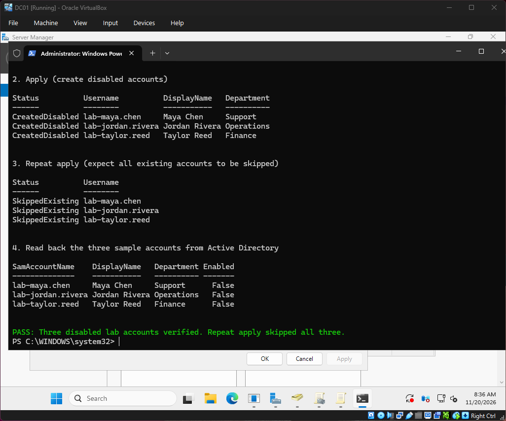

# PowerShell New Hire Onboarding Lab

This project stages three fictional new hires in my [Active Directory help desk lab](https://github.com/zackph/active-directory-help-desk-lab). It demonstrates how a help desk can review a batch from a spreadsheet, create directory accounts consistently, and safely rerun the same batch.

| Sample hire | Username | Department |
| --- | --- | --- |
| Maya Chen | `lab-maya.chen` | Support |
| Jordan Rivera | `lab-jordan.rivera` | Operations |
| Taylor Reed | `lab-taylor.reed` | Finance |

## How it works

- `new-hires.csv` supplies names, usernames, departments, and job titles.
- `Invoke-LabOnboarding.ps1` validates the CSV and checks for directory identity conflicts. It previews by default. With `-Apply`, it creates missing accounts under `ad.example.test → training → Onboarding` and skips matching users. The accounts are staged disabled, with no passwords in the CSV or script.
- `Test-LabOnboarding.ps1` runs the preview, apply, and repeat checks, then reads back the three sample accounts. It checks their names, usernames, departments, titles, sign-in names, and disabled status.

## Run it in the lab

Open **Windows PowerShell** inside the `DC01` VM using your lab administrator session. Keep the three files in one folder. The Active Directory PowerShell module and the existing `training` organizational unit are required.

From that folder, preview the CSV and review the three rows:

```powershell
.\Invoke-LabOnboarding.ps1
```

On a clean run, the preview lists `WouldCreate` for all three. Then run the end-to-end check:

```powershell
.\Test-LabOnboarding.ps1 -Apply
```

The first apply on a clean lab should show `CreatedDisabled` for all three. The repeat apply should show `SkippedExisting` for each. In **Server Manager → Tools → Active Directory Users and Computers**, expand **ad.example.test → training → Onboarding** and refresh the view to inspect the accounts.

## Verification

The preview, duplicate input rejection, directory conflict check, account creation, and repeat-run behavior passed against a simulated directory using Windows PowerShell 5.1. I then ran the end-to-end test on the actual DC01 domain controller.

| Live check | Result |
| --- | --- |
| First apply | Created all three accounts as disabled (`CreatedDisabled`). |
| Repeat apply | Skipped all three existing accounts (`SkippedExisting`). |
| Active Directory readback | Verified Maya Chen, Jordan Rivera, and Taylor Reed under `training → Onboarding`. All three showed `Enabled: False`. |


